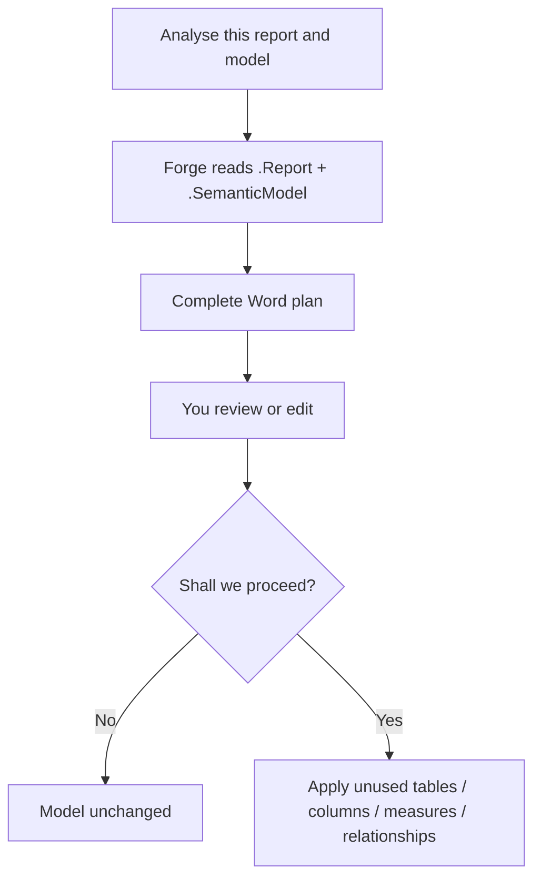

# Semantic Forge

You point Forge at a Power BI report and semantic model. It writes a Word plan of unused or unusual tables, columns, measures, and relationships. Nothing is deleted until you say yes.

Cursor MCP · Setup ~ 5 minutes, once · Saves ~ 2 to 4 hours per model

---

## What you will see

| On the screen | In simple words |
|---------------|-----------------|
| **Word plan** | A list of unused or unusual tables, columns, measures, and relationships, with why each was flagged. |
| **Shall we proceed?** | A yes/no stop. Yes applies the plan. No leaves the model unchanged. You can edit the plan first. |
| **After yes** | Those unused objects are removed or cleaned. Visuals that still use a field are not dropped. |

---

## Who this is for

Anyone who owns a .pbip dashboard and wants a smaller, cleaner model before review.

---

## Before vs after

| Without Semantic Forge | With Semantic Forge |
|---|---|
| Hunting unused columns and measures by hand, or in a long AI chat, takes hours and still misses objects. | One Word plan. You review it. You say yes or no. The model changes only on yes. |

**About 2 to 4 hours back per model**

---

## How it works



---

## Setup — once

1. Open Cursor on the Semantic Forge project.
2. Type exactly: **Setup Semantic Forge**
3. If it asks for a report folder, model folder, or a login, answer once.
4. Ask it to analyse your dashboard (daily use below).

**You are done when Forge can read your report and model and offers a Word plan.**

---

## Daily use

Ask: `Analyse this report and semantic model. Write the full Word plan.`

Give the .Report folder and the .SemanticModel folder when asked. After you read the plan: **Yes, proceed** or **No**.


---

## Example

```
Shall we proceed with the optimization?

Plan highlights:
- Unused measure: <name> — not used on any page
- Unused column: <table>[<column>] — no visual binds to it
- Relationship with no query path

Yes = apply. No = stop.
```

---

## If this happens

| If you see | Do this |
|------------|---------|
| Dashboard files changed | Confirm visuals still bind after unused objects are removed. Then run Semantic Scout before the PR. |

---

## If something fails

| What you see | What to do |
|--------------|------------|
| MCP will not start | Say Setup Semantic Forge. Restart Cursor. |
| Empty dashboard list | Onboard first: give report and model paths. |
| False unused object | Leave it in the plan as skip. Do not delete a field a visual still uses. |
